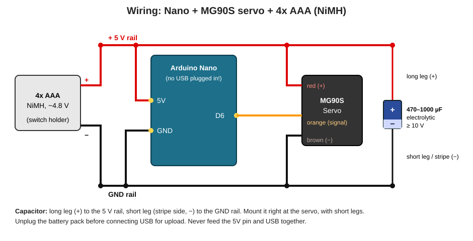

# zopf

Zopf Maschine Esther

## Wiring

Servo sweep on an Arduino Nano, powered by 4x AAA NiMH cells (~4.8 V) connected to the Nano's **5V pin** (not VIN).

| Part | Connects to |
|------|-------------|
| Battery + | Nano 5V, servo red |
| Battery - | Nano GND, servo brown |
| Servo signal (orange) | Nano D6 |
| Capacitor (470-1000 uF, >=10 V) | + leg (long) to servo red / 5V, - leg (short, stripe) to servo brown / GND, placed right at the servo |

Unplug the battery pack before connecting USB to upload.
